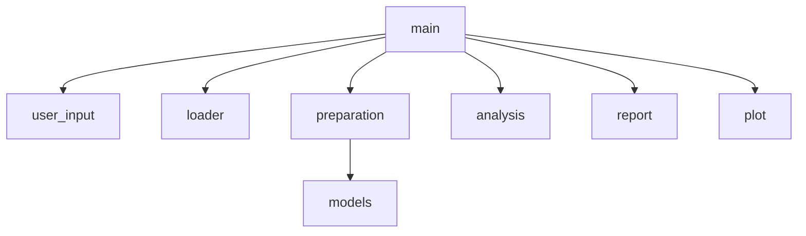

# EVACodeC4

Analyses NASA EVA (spacewalk) records from `eva-data.json` for a chosen year range:

- EVA duration categories (Short < 4h, Standard 4–7h, Long ≥ 7h)
- Top 5 astronauts by EVA time
- Comparison of two countries (EVA count, total hours, average hours, leader or tie)
- Cumulative EVA hours plot, saved to `cumulative_duration.png`

## Setup

Requires Python 3.10+.

```
python -m venv venv
source venv/bin/activate        # Windows: venv\Scripts\activate
pip install -r requirements.txt
```

## Run

```
python main.py
```

You will be asked for a start year, end year, Country A and Country B (e.g. `1965`, `2020`, `USA`, `Russia`). Invalid years are asked again; unknown countries produce a warning and are reported with zero EVAs.

## Tests

```
python -m unittest discover -s tests -v
```

Tests use small in-memory records, so they do not read the JSON file or open the plot.

## Module structure



| Module | Responsibility |
|---|---|
| `main.py` | Coordinates execution: reads input, calls each stage in order |
| `user_input.py` | Reads and validates years and country names from the user |
| `loader.py` | Reads the raw JSON file |
| `preparation.py` | Validates and parses records, filters by year, matches country names |
| `models.py` | `EVARecord` dataclass shared between modules |
| `analysis.py` | All calculations (cumulative hours, country totals, categories, top crew, country comparison) |
| `report.py` | Prints results to the terminal |
| `plot.py` | Draws and saves the cumulative hours chart |
| `tests/` | Automated tests |
| `evacodev2` | Original single-file script, kept for reference |

## Architectural decisions

ADRs are in [`docs/adr/`](docs/adr/):

- [ADR 001: Split the script into responsibility-based modules](docs/adr/ADR-001-modular-structure.md)
- [ADR 002: Test analysis as pure functions with unittest](docs/adr/ADR-002-testing-approach.md)

Structural changes made while adding the country comparison are recorded in [`docs/architecture-changes.md`](docs/architecture-changes.md).
